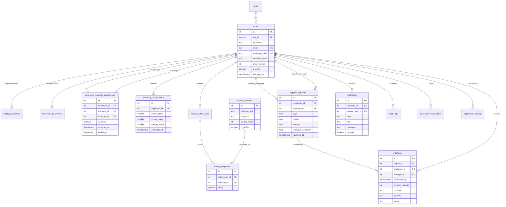

# Architecture, assumptions and database design

## 1. Requirements analysis and assumptions

The specification leaves some points open. These are the decisions made, each chosen to be the least surprising and the easiest to change.

| Topic | Decision |
|---|---|
| Employee ID | A staff number every user has, including Line Managers and HR. Anyone can sign in with email or Employee ID. Stored upper-case, unique. |
| Registration | Self-registration always creates an **Employee**. Line Managers and HR/Admin users are created by HR, or an existing user's role is changed. The first HR/Admin comes from the seed data or `npm run create-admin`. |
| Rating scale | Mood and Energy: 1 = very low … 5 = excellent. **Stress is recorded literally: 1 = very low stress, 5 = very high stress**, so lower is better. The UI labels and analytics say so. |
| "Per day" | A calendar day in the organization time zone (setting, default `Asia/Karachi`), not the server's or the browser's. The limit resets at local midnight and the employee is told when. |
| Survey frequency | An employee can submit the survey once per cycle; a new cycle starts N days after their last submission (setting, default 30). |
| Changing questions | Questions are never deleted, only deactivated, so past answers keep their meaning. A submission must answer every question active at that moment. |
| Requests without a manager | An employee with no assigned Line Manager cannot create a request and is told to contact HR. HR sees a warning on the dashboard. |
| Duplicate requests | One pending request per type per employee. An employee can withdraw a pending request. |
| Reassignment | When HR moves an employee to another manager, their pending requests move too. |
| Cancelled meetings | If a meeting that came from a discussion request is cancelled, the request returns to Pending so it can be rescheduled. |
| Role change | Ends the user's current assignments (in either direction) and cancels their upcoming meetings, with notifications. Takes effect on the next request. |
| HR and individual data | HR manages accounts and sees aggregates. It cannot read individual ratings, survey answers or request contents (see section 5). |
| Password reset | Real token flow; delivery by email is left as an integration point (see README). |
| Account deactivation | Blocks sign-in and existing sessions immediately. Data is retained. |

## 2. Technology stack

| Concern | Choice | Reason |
|---|---|---|
| Frontend | React 19 + TypeScript + Vite | The stack named in the brief; a single-page app suits a dashboard behind a login, so server rendering (Next.js) adds nothing here. |
| Styling | Tailwind CSS 4 with a small in-house component kit | Consistent corporate look without a heavy component dependency. |
| Charts | Hand-written SVG components | Three chart types are needed; this avoids a large charting library and keeps full control over accessibility. |
| Routing | React Router 6 | Standard; guards redirect by role. |
| Backend | Express 4 + TypeScript | Small, well understood, and the module-per-folder structure gives the organization NestJS would without its ceremony. |
| Validation | Zod | One schema validates and types each request. |
| Database access | `pg` with hand-written SQL | The reporting and time-zone queries are clearer in SQL than through an ORM, and the schema is small. |
| Migrations | Ordered `.sql` files with a tiny runner | Transparent and reviewable. |
| Authentication | JWT (HS256) in the `Authorization` header | Stateless; no cookies, so no CSRF surface. The user is re-read from the database on every request, so deactivation, role changes and password resets apply instantly. |
| Password hashing | scrypt from Node's `crypto` (N=32768, r=8, p=1, random 16-byte salt) | Memory-hard, built in, no native add-on to compile. Parameters are stored with each hash. |
| Tests | `node:test` + `fetch` against a real PostgreSQL database | Exercises the real SQL, constraints and locks. |

## 3. System architecture

```
Browser (React SPA)
   │  HTTPS, JSON, Authorization: Bearer <JWT>
   ▼
Express API  /api/v1
   helmet → CORS → JSON body → router
     per route:  rate limit (auth only) → authenticate → authorize(role) → validate(Zod) → handler
     handler → service (business rules, ownership checks, transactions)
                 ├─ notification service ──► notifications table ──► EventEmitter (future push/WebSocket)
                 └─ audit service ────────► audit_logs table
   error handler → { success: false, error: { code, message, details } }
   ▼
PostgreSQL
```

Rules that matter are enforced in the service layer and, where possible, by the database:

- **Ownership** is part of the SQL (`WHERE employee_id = $me`, `WHERE manager_id = $me`). A record that belongs to someone else is reported as *404 Not Found*, so its existence is not revealed.
- **Daily limit**: the count and insert run in one transaction holding a per-employee advisory lock, so simultaneous submissions cannot exceed the limit.
- **Request decisions** lock the request row (`SELECT … FOR UPDATE`), so a request cannot be approved twice or approved and rejected at once.
- **One current manager per employee** is a partial unique index.
- Every state-changing action writes an audit row in the same transaction as the change.

The frontend hides pages a role cannot use and redirects on manual URL entry, but this is convenience only; the API is the security boundary.

## 4. Database design

### Tables

| Table | Purpose |
|---|---|
| `roles` | The three roles: `EMPLOYEE`, `LINE_MANAGER`, `HR_ADMIN`. |
| `users` | Identity and credentials for everyone: name, email, Employee ID (`employee_code`), password hash, active flag, `token_version` (bumped to invalidate sessions). |
| `employee_profiles` | One per employee: department, designation. |
| `line_manager_profiles` | One per Line Manager: department, designation. |
| `employee_manager_assignments` | Which employee reports to which manager. `is_active` marks the current row; ended rows are history. |
| `wellbeing_assessments` | One check-in: mood, stress, energy (1–5) and submission time. |
| `survey_questions` | The question bank: text, category, order, active flag. |
| `survey_submissions` | One completed survey by an employee at a time. |
| `survey_responses` | One answer (1–5) per question per submission. |
| `support_requests` | Break and discussion requests with status, the employee's note, the manager's comment and who resolved it when. |
| `meetings` | Scheduled meetings (optionally linked to a discussion request): time, duration, purpose, location, status. |
| `notifications` | In-app notifications: recipient, related user, title, message, read flag. |
| `application_settings` | Key/value settings editable by HR. |
| `password_reset_tokens` | SHA-256 hashes of single-use reset tokens with expiry. |
| `audit_logs` | Append-only record of actions: actor, action, entity, details, IP, time. |
| `schema_migrations` | Which migration files have been applied. |

All tables have an identity primary key; all except the append-only `audit_logs` have `created_at` and `updated_at` (maintained by a trigger). Ratings, statuses and types are protected by `CHECK` constraints.

### Relationships

- `roles` 1 — N `users`
- `users` 1 — 0..1 `employee_profiles`; `users` 1 — 0..1 `line_manager_profiles`
- `users` (employee) 1 — N `employee_manager_assignments` N — 1 `users` (manager); at most one active row per employee
- `users` 1 — N `wellbeing_assessments`
- `users` 1 — N `survey_submissions` 1 — N `survey_responses` N — 1 `survey_questions`
- `users` (employee) 1 — N `support_requests` N — 1 `users` (manager)
- `support_requests` 1 — 0..N `meetings` (at most one not cancelled); `meetings` N — 1 `users` (employee), N — 1 `users` (manager)
- `users` 1 — N `notifications` (recipient); `notifications` N — 0..1 `users` (related user)
- `users` 1 — N `audit_logs` (actor); `users` 1 — N `password_reset_tokens`
- `application_settings` N — 0..1 `users` (last updated by)

### ERD



The exact DDL is in `backend/migrations/001_initial_schema.sql`.

### Status lifecycles

- Break request: `PENDING` → `APPROVED` | `REJECTED` | `CANCELLED` (withdrawn by the employee)
- Discussion request: `PENDING` → `SCHEDULED` → `COMPLETED`; `SCHEDULED` → `PENDING` if the meeting is cancelled; `PENDING` → `CANCELLED`
- Meeting: `SCHEDULED` → `COMPLETED` | `CANCELLED`

## 5. Privacy and data access

| Data | Employee (own) | Line Manager (assigned employees only) | HR / Admin |
|---|---|---|---|
| Profile: name, ID, department, designation | Read, edit | Read | Read, manage |
| Well-being ratings | Read | **No** | Aggregated averages only |
| Survey answers | Read | **No** | Aggregated per question only |
| Whether/when a check-in or survey was completed | Read | Read | Counts per user |
| Break/discussion requests incl. the note | Read, create, withdraw | Read, decide | Volumes and status totals only |
| Meetings | Read | Read, manage own | Count only |
| Audit log | — | — | Read |

Averages are withheld (returned as `null`, shown as "Hidden") whenever fewer than `analytics_min_group_size` employees contributed (default 3), so a small department or a quiet day cannot expose one person. The same notice is shown to users in the app under **Privacy** and is linked from the registration page.

## 6. Notifications

| Event | Recipient |
|---|---|
| Break requested / discussion requested | Line Manager |
| Break approved / rejected (with the comment) | Employee |
| Meeting scheduled / updated (date, time, duration, place, purpose) / cancelled (reason) | Employee |
| Request withdrawn | Line Manager |
| Line Manager assigned; new team member | Employee; Line Manager |

## 7. Implementation phases

1. Project setup, schema, migrations, environment validation
2. Authentication and role-based access control
3. Employee module (check-ins with daily limit, survey, requests)
4. Line Manager module (team, request decisions, meetings)
5. HR/Admin module (users, assignments, survey management)
6. Notifications
7. Analytics, settings, audit log
8. Tests
9. Documentation
